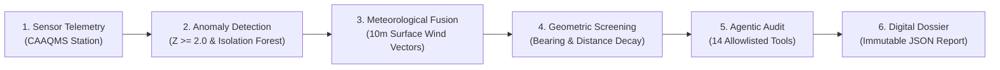
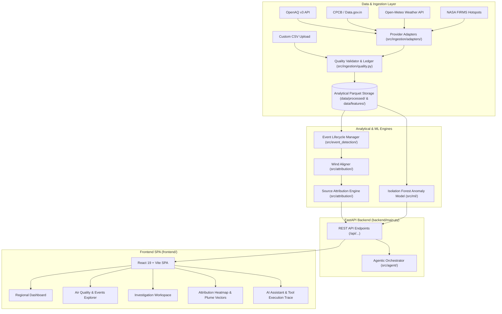

# AIR KAVACH (एयर कवच)

> **Agentic Industrial Pollution Source Attribution and Environmental Intelligence Platform**  
> *Pan-India Environmental Intelligence · Meteorological Dispersion Screening · Leakage-Free Analytics · Full-Stack Operational System*

---

## 1. Project Title
**AIR KAVACH (एयर कवच)** — An open, reproducible environmental intelligence and industrial source candidate attribution platform.

## 2. Professional Tagline
**Agentic Industrial Pollution Source Attribution and Environmental Intelligence Platform**

---

## 3. Overview
AIR KAVACH is an end-to-end environmental intelligence platform designed to systematically investigate air quality elevation episodes recorded by Continuous Ambient Air Quality Monitoring Stations (CAAQMS). When an atmospheric sensor detects elevated particulate matter ($\text{PM}_{2.5}$ or $\text{PM}_{10}$) or gaseous pollutants, AIR KAVACH evaluates *where* the elevation occurred, *when* the spike took place, *what* meteorological transport regime prevailed, and *which* candidate industrial facilities were geographically upwind during the episode.

The system combines statistical rolling baselines, unsupervised machine learning anomaly detection, surface wind trajectory analysis, geospatial candidate facility screening, and an agentic multi-tool investigation workflow to compile immutable, disaggregated digital forensic dossiers.

---

## 4. Problem Statement
Urban and industrial airsheds across India frequently experience severe, localized air pollution episodes. While ambient monitoring networks (such as CPCB and State PCB CAAQMS stations) record real-time pollutant concentrations, public dashboards typically report only aggregated numbers (such as the Air Quality Index, AQI) without answering:
1. **Source Plausibility:** Which nearby industrial zones or emission sources were physically upwind during the event?
2. **Meteorological Transport:** Was the spike driven by directional advection from a localized source, regional transport, or microscale stagnation under calm wind conditions?
3. **Temporal Baseline Isolation:** Is the observed elevation a genuine statistical anomaly relative to recent historical hours, or part of a regular diurnal pattern?
4. **Investigation Reproducibility:** Environmental authorities often lack an auditable, deterministic tool chain that logs raw telemetry, mathematical steps, and evidentiary limitations in a single reproducible report.

---

## 5. Proposed Solution
AIR KAVACH addresses these gaps through a four-stage analytical pipeline:
- **Strict Ingestion & Quality Validation:** Ingests CAAQMS sensor telemetry, surface meteorology, and industrial facility registries with physical bounds checks, staleness detection, and deduplication.
- **Leakage-Free Anomaly Detection:** Identifies elevation episodes using a strictly past-only rolling baseline (`shift(1).rolling(96)`) combined with an Isolation Forest unsupervised anomaly detector, avoiding any lookahead contamination.
- **Meteorological Upwind Screening:** Calculates circular mean wind vectors using the meteorological standard (wind direction **FROM** which the wind originates) and evaluates geometric candidate source alignment with exponential distance decay.
- **Autonomous Agentic Audit:** Orchestrates 14 deterministic analytical tools to synthesize verified facts, examine wind-source alignment, evaluate evidence strength, and generate an immutable investigation dossier.

---

## 6. Key Capabilities Already Implemented
- **Multi-Provider Data Ingestion:** Modular adapters for OpenAQ v3, CPCB / Data.gov.in, Open-Meteo Weather, Open-Meteo Air Quality, NASA FIRMS, and industrial CEMS.
- **Interactive Ingestion Intake UI:** Web-based CSV upload, automated schema mapping, preview validation, and persistent intake ledger.
- **Pan-India Geographical Isolation:** Canonical ISO-style geographical registry (`in-mp-indore`, `in-dl-delhi`, `in-mh-mumbai`, `in-gj-ahmedabad`, `in-ka-bengaluru`, `in-up-kanpur`). Regions without active live telemetry report status without cross-region data leakage.
- **Past-Only Rolling Baseline:** Zero lookahead bias; baseline mean and standard deviation are computed strictly using observations preceding the target timestamp.
- **Unsupervised Anomaly Scoring:** 300-tree scikit-learn Isolation Forest model trained on multi-scale rolling statistics.
- **Meteorological Wind Vector Analysis:** Adherence to meteorological convention; calculates forward azimuths, circular angle differences with wraparound, and calm-wind diffusion flags.
- **Industrial Candidate Screening:** Evaluates distance, angular match, and facility category weights to rank plausible upwind sources.
- **Investigation Workspace:** Forensic inspection UI with in-page incident switcher, benchmark episodes, observed telemetry facts, wind dispersion cards, candidate source rankings, and missing-evidence audit.
- **Agentic AI Orchestrator:** Multi-step deterministic tool executor returning structured execution traces.
- **Automated Dossier Generation:** Compiles and saves immutable JSON investigation dossiers with cryptographic request tracking.
- **Dual-Mode Containerization:** Production-grade Docker Compose architecture serving the FastAPI backend and React/Vite SPA through an Nginx reverse proxy with health checks.

---

## 7. How the Investigation Workflow Works



1. **Detection:** A monitoring station records a spike where pollutant concentration exceeds the historical rolling threshold ($Z \ge 2.0$) or ML anomaly threshold.
2. **Meteorological Colocation:** Surface wind telemetry (speed and direction) is temporally aligned with the elevation window.
3. **Upwind Plume Projection:** An upwind cone is projected opposite the wind direction to identify facilities located in the source corridor.
4. **Candidate Scoring:** Candidate facilities within the screening radius (default: 25 km) are scored on distance and angular alignment.
5. **Forensic Audit:** The autonomous agent checks telemetry, verifies baseline integrity, reviews candidates, and checks for calm-wind regimes.
6. **Report Export:** An official investigation dossier is generated and persisted to disk.

---

## 8. Existing System Architecture



---

## 9. Technology Stack

### Backend
- **Framework:** FastAPI 0.119+ / Starlette
- **Server:** Uvicorn (ASGI)
- **Language:** Python 3.13+
- **Data Processing:** Pandas, NumPy, PyArrow (Apache Parquet storage)
- **Machine Learning:** Scikit-learn (Isolation Forest), SciPy
- **Geospatial Analytics:** Geopandas, Shapely, PyProj, Haversine spherical geometry

### Frontend
- **Framework:** React 19 (Hooks, Context, Functional Components)
- **Build Tool:** Vite 8
- **Styling:** Custom CSS Design System (no heavy UI frameworks, strict semantic tokens)
- **Visualizations:** Chart.js, React-Chartjs-2
- **Maps:** Leaflet, React-Leaflet
- **Icons:** Lucide-React

### Deployment & DevOps
- **Containerization:** Docker (Multi-stage builds)
- **Orchestration:** Docker Compose / Compose Spec (`compose.yaml`)
- **Web Server:** Nginx Alpine (SPA routing & API reverse proxy)
- **Testing:** Pytest, AnyIO, Chrome DevTools Protocol (CDP) live browser automation

---

## 10. Data Sources & Actual Integration Status

| Provider / Feed | Type | Integration Status | Notes / Description |
| :--- | :--- | :--- | :--- |
| **OpenAQ v3 API** | In-situ CAAQMS | **Live & Historical** | Ingests continuous measurements for CAAQMS stations across India. |
| **CPCB / Data.gov.in** | Regulatory CAAQMS | **Adapter Implemented** | Normalized ingestion adapter; parses standard CPCB tabular records. |
| **Open-Meteo Weather** | Meteorological Observations | **Live & Historical** | 10m surface wind speed, wind direction, temperature, and relative humidity. |
| **Open-Meteo Air Quality** | Atmospheric Chemistry Model | **Modeled Only** | Strictly labeled as synthetic/modeled data; never treated as physical sensor truth. |
| **NASA FIRMS** | Satellite Thermal Hotspots | **Adapter Implemented** | Ingests MODIS/VIIRS thermal anomaly coordinates for biomass/open fire screening. |
| **Industrial CEMS** | Stack Flue Gas Telemetry | **Adapter Implemented** | Adapter handles in-stack mass emission rates; candidate facilities currently lack live public telemetry. |
| **Industrial Facility Registry** | Geospatial Inventory | **Curated Dataset** | Geospatial polygon/centroid inventory for industrial zones (Sanwer Road, Pithampur, etc.). |

---

## 11. ML & Anomaly Detection Methodology
1. **Past-Only Rolling Baseline:**
   - Evaluates a 96-hour (4-day) rolling window lagged by 1 step (`.shift(1)`).
   - This prevents elevation peaks from inflating their own baseline or masking onset anomalies.
2. **Z-Score Thresholding:**
   - A potential episode is flagged when:
     $$\Delta = \text{PM}_{2.5} - \mu_{\text{rolling}} \ge 2.0 \cdot \sigma_{\text{rolling}}$$
3. **Isolation Forest Classifier:**
   - An ensemble of 300 isolation trees evaluates multidimensional features:
     - Instantaneous pollutant concentration
     - Ratio to 24-hour rolling mean
     - Rate of concentration change ($\Delta / \Delta t$)
     - Local diurnal variance
   - Anomalies receive an unsupervised anomaly score between 0.0 and 1.0.

---

## 12. Wind Alignment & Geospatial Screening Methodology
Attribution relies on meteorological transport physics:

1. **Wind Vector Convention:**
   - Wind direction $\theta_{\text{wind}}$ is defined meteorologically as the direction **FROM** which the wind blows ($0^\circ = \text{North}$, $90^\circ = \text{East}$, $180^\circ = \text{South}$, $270^\circ = \text{West}$).
2. **Upwind Bearing Calculation:**
   - The bearing $\beta$ from the receptor sensor to candidate facility $F$ is calculated using forward spherical azimuth:
     $$\beta = \text{atan2}(\sin \Delta \lambda \cos \phi_2, \cos \phi_1 \sin \phi_2 - \sin \phi_1 \cos \phi_2 \cos \Delta \lambda)$$
3. **Circular Angle Difference:**
   - The angular deviation $\Delta \theta$ between wind origin and facility bearing accounts for $360^\circ$ circular wraparound:
     $$\Delta \theta = |\theta_{\text{wind}} - \beta| \pmod{360^\circ}, \quad \Delta \theta = \min(\Delta \theta, 360^\circ - \Delta \theta)$$
4. **Exponential Distance Decay:**
   - Atmospheric dispersion rapidly dilutes particulate plumes over distance:
     $$S_{\text{distance}} = \exp\left(-\frac{d}{d_{\text{scale}}}\right), \quad d_{\text{scale}} = 10\text{ km}$$
5. **Calm-Wind Handling:**
   - When mean wind speed $u < 0.5\text{ m/s}$, directional plume transport breaks down; the system flags calm wind stagnation and suppresses directional certainty.

---

## 13. Evidence Interpretation & Scientific Limitations

> [!IMPORTANT]
> **LEGAL & SCIENTIFIC ATTRIBUTION NOTICE**
> 
> Scores generated by AIR KAVACH are **geometric and meteorological screening scores**, NOT calibrated probabilities of legal causation.

1. **No In-Stack Verification:** Unless a facility has live, authenticated CEMS telemetry confirming an operational exceedance during the episode window, a high attribution score indicates only that the facility was *located in the upwind transport corridor*.
2. **Two-Dimensional Wind Simplification:** The system uses 10m surface wind telemetry. It does not model vertical wind shear, planetary boundary layer (PBL) mixing height, thermal buoyancy, or complex terrain wake turbulence.
3. **Unmonitored Sources:** Non-industrial sources in the same upwind sector (such as vehicular traffic, construction dust, waste burning, or domestic fuel use) may contribute to the observed sensor concentration without appearing in the industrial facility registry.

---

## 14. Project Directory Structure

```
AIR-KAVACH/
├── backend/                  # FastAPI backend application
│   ├── main.py               # API route definitions and service entry point
│   ├── map_data.json         # GeoJSON and precomputed geospatial layers
│   └── Dockerfile            # Backend container configuration
├── frontend/                 # React 19 + Vite single page application
│   ├── src/
│   │   ├── components/       # Shared UI components (RegionSelector, etc.)
│   │   ├── pages/            # View pages (Workspace, Attribution, Dashboard)
│   │   ├── api.js            # Frontend API client
│   │   ├── App.jsx           # Main navigation and application shell
│   │   └── index.css         # Semantic design system tokens
│   ├── nginx.conf            # Nginx reverse proxy configuration
│   ├── package.json          # Node dependencies
│   └── Dockerfile            # Frontend container configuration
├── src/                      # Core analytical libraries
│   ├── agent/                # Agentic orchestrator and 14 allowlisted tools
│   ├── attribution/          # Wind vector aligner & geospatial screening
│   ├── event_detection/      # Lifecycle manager & past-only rolling baseline
│   ├── geo/                  # Pan-India regional registry
│   ├── ingestion/            # Provider adapters, intake ledger, validator
│   ├── ml/                   # Isolation Forest anomaly scoring service
│   └── utils/                # Configuration and path management
├── data/                     # Analytical Parquet storage & ingestion lake
│   ├── processed/            # Cleaned CAAQMS observations and wind data
│   └── features/             # Feature parquets, distances, and ML scores
├── models/                   # Serialized ML artifacts
│   └── isolation_forest/     # Trained scikit-learn model files
├── reports/                  # Generated investigation dossiers (JSON)
├── tests/                    # Automated Pytest test suite (61 tests)
├── docs/                     # Architectural reports & documentation
├── compose.yaml              # Docker Compose deployment specification
├── docker-compose.yml        # Legacy Docker Compose specification
├── Dockerfile.backend        # Root backend Dockerfile
├── Dockerfile.frontend       # Root frontend Dockerfile
├── requirements.txt          # Python dependencies
├── .env.example              # Environment variables template
└── README.md                 # Project documentation
```

---

## 15. Prerequisites

- **Python:** 3.11, 3.12, or 3.13 (Python 3.13 recommended)
- **Node.js:** Node.js 20+ (Node.js 24 recommended) with `npm`
- **Docker:** Docker Engine 24+ and Docker Compose v2+ (optional, for containerized run)

---

## 16. Installation Without Docker

### 1. Clone Repository & Setup Virtual Environment
```bash
git clone https://github.com/Afsar426/-AIR-KAVACH.git
cd -AIR-KAVACH

# Windows PowerShell
python -m venv .venv
.\.venv\Scripts\Activate.ps1

# Linux / macOS
python3 -m venv .venv
source .venv/bin/activate
```

### 2. Install Python Dependencies
```bash
pip install --upgrade pip
pip install -r requirements.txt
```

### 3. Setup Frontend
```bash
cd frontend
npm install
cd ..
```

### 4. Start Services Locally

**Terminal 1 — FastAPI Backend:**
```bash
# From repository root
uvicorn backend.main:app --host 0.0.0.0 --port 8000 --reload
```

**Terminal 2 — React/Vite Frontend:**
```bash
cd frontend
npm run dev
```

The frontend will be available at `http://localhost:5173` and the backend at `http://localhost:8000`.

---

## 17. Docker Setup

To run the complete platform inside isolated production containers:

### 1. Build and Start Containers
```bash
docker compose up --build -d
```

### 2. Verify Running Services
```bash
docker compose ps
```
Both containers will report `healthy`:
- `air-kavach-backend`: Listening on `0.0.0.0:8000`
- `air-kavach-frontend`: Listening on `0.0.0.0:3000` (Nginx serving React SPA)

### 3. View Logs
```bash
# Follow backend logs
docker compose logs -f backend

# Follow frontend logs
docker compose logs -f frontend
```

### 4. Stop Containers
```bash
docker compose down
```

---

## 18. Environment Variable Configuration

Copy `.env.example` to `.env` in the project root:

```bash
cp .env.example .env
```

| Variable | Required? | Default | Description |
| :--- | :--- | :--- | :--- |
| `PORT` | Optional | `8000` | Port for FastAPI backend service. |
| `HOST` | Optional | `0.0.0.0` | Host interface binding for Uvicorn. |
| `OPENAQ_API_KEY` | Optional | `""` | OpenAQ v3 API key for high-rate data synchronization. |
| `GEMINI_API_KEY` | Optional | `""` | Google Gemini API key (falls back to deterministic agent). |
| `DATA_DIR` | Optional | `data` | Base directory for Parquet data lake. |
| `MODELS_DIR` | Optional | `models` | Base directory for serialized model checkpoints. |
| `REPORTS_DIR` | Optional | `reports` | Base directory for saved investigation reports. |

---

## 19. API Documentation Instructions

When the backend is running, interactive API documentation is available:
- **Swagger UI:** [http://localhost:8000/docs](http://localhost:8000/docs)
- **ReDoc:** [http://localhost:8000/redoc](http://localhost:8000/redoc)
- **Health Probe:** [http://localhost:8000/health](http://localhost:8000/health)
- **Readiness Probe:** [http://localhost:8000/ready](http://localhost:8000/ready)

Key API Endpoints:
- `GET /api/summary`: Air quality summary metrics by region.
- `GET /api/stations`: Registered monitoring stations with active status.
- `GET /api/events`: Detected pollution elevation episodes.
- `GET /api/events/{event_id}`: Granular episodic telemetry.
- `GET /api/attribution/{event_id}`: Candidate industrial source rankings and wind vectors.
- `POST /api/reports/generate`: Generates an immutable investigation report.
- `POST /api/agent/query`: Executes agentic multi-tool investigation workflow.

---

## 20. Testing Instructions

### 1. Backend Automated Test Suite
Run the 61 automated tests verifying adapter normalization, anomaly detection, wind physics, geographic isolation, and API endpoints:

```bash
pytest
```
*Expected: 61 passed with zero regressions.*

### 2. Frontend Production Build Check
```bash
cd frontend
npm run build
```
*Expected: Clean Vite bundling without errors.*

---

## 21. Example Investigation Workflow

1. Navigate to **Investigation Workspace** (`http://localhost:3000/#workspace/EVT-0001` or `http://localhost:5173/#workspace/EVT-0001`).
2. Examine the detected episode facts (e.g. `EVT-0001` at Maguda CAAQMS: baseline $72.4\text{ }\mu\text{g/m}^3$, peak $284.0\text{ }\mu\text{g/m}^3$, duration 3 hours).
3. Review the **Weather Telemetry**: surface wind direction $242^\circ$ (WSW), wind speed $3.2\text{ m/s}$.
4. Inspect the **Candidate Industrial Rankings**: facilities located in the $240^\circ \pm 30^\circ$ quadrant scored higher due to direct upwind alignment.
5. Review the **Missing Evidence Audit**: explicitly notes that stack CEMS data is absent and plume transport is a 2D surface approximation.
6. Click **Generate Official Report** to compile and download an immutable JSON dossier with full provenance tracking.

---

## 22. Security & Data Privacy

- **No Hardcoded Secrets:** Dockerfiles, source files, and repository assets contain zero API keys or credentials.
- **Environment Isolation:** Local `.env` files are excluded by `.gitignore` and `.dockerignore`.
- **Read-Only Defaults:** Docker Compose runs without privileged mode. Host volumes are limited to `./data`, `./models`, and `./reports`.
- **CORS Restricted:** FastAPI CORS middleware explicitly binds to permitted origins.
- **Truthful Identity:** Synthetic or modeled feeds (such as Open-Meteo Air Quality) are strictly tagged as `modeled` to prevent misrepresentation as in-situ sensor data.

---

## 23. Known Limitations

1. **Surface Anemometer Elevation:** Calculations utilize 10-meter surface wind observations. Regional transport at higher planetary boundary layer altitudes is not accounted for.
2. **Missing In-Stack Verification:** Real-time stack emissions telemetry (CEMS) is not publicly available for candidate facilities; scores reflect potential upwind corridor presence, not direct measured emissions.
3. **Sensor Density:** Air quality sensor networks in Indian cities are sparse; spatial interpolation between stations has higher uncertainty outside station radii.

---

## 24. Troubleshooting

- **Port Conflict (8000 or 3000 in use):**
  - Verify existing processes: `netstat -ano | findstr 8000` (Windows) or `lsof -i :8000` (Linux).
  - Stop any conflicting local instances before running Docker Compose.
- **Docker Daemon Unavailable:**
  - Ensure Docker Desktop is running before invoking `docker compose up`.
- **Missing Analytical Parquet Files:**
  - Verify that `data/processed/` and `data/features/` contain the expected parquets. Check `GET /ready` to inspect file readiness.

---

## 25. Responsible-Use Disclaimer

AIR KAVACH is designed for research, environmental screening, and intelligence assistance. It is intended to help regulatory bodies, researchers, and civil society identify where emissions investigations should focus. **Attribution rankings must not be used as the sole basis for punitive or legal action without independent physical ground inspection and stack telemetry confirmation.**

---

## 26. Future Scope

- Integration with WRF-Chem and CALPUFF dispersion modeling suites.
- High-resolution satellite trace gas integration (Sentinel-5P TROPOMI for $\text{NO}_2$ and $\text{SO}_2$ columns).
- Direct real-time ingestion from state PCB public CEMS portals.
- 3D plume rise modeling using lidar boundary-layer height observations.

---

## 27. Contribution Guidelines

1. Fork the repository and create a feature branch (`git checkout -b feature/improvement`).
2. Ensure all changes preserve scientific defensibility and past-only baseline calculations.
3. Run the automated test suite (`pytest`) and verify 100% pass rate.
4. Run the frontend production build (`npm run build`).
5. Submit a pull request with a clear description of changes.

---

## 28. License

Distributed under the Apache 2.0 License. See `LICENSE` for more information.
