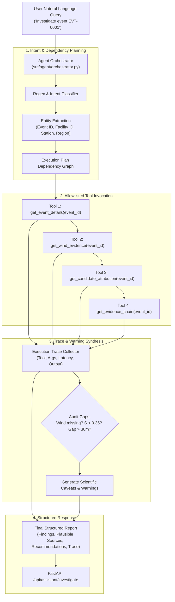

# AIR KAVACH - Agentic AI Orchestration & Tool Registry Specification

## 1. Architectural Philosophy

The AIR KAVACH Agentic AI system (`src/agent/`) is built on three core engineering tenets:
1. **Strict Tool-Calling Verification**: The agent never hallucinates or fabricates telemetry; every factual claim in an investigation report must be backed by a deterministic execution trace against an allowlisted backend tool.
2. **Explicit Uncertainty & Missing-Evidence Auditing**: If meteorological data is incomplete, wind alignment is ambiguous, or a facility is downwind, the agent automatically flags these gaps as high-priority caveats.
3. **Deterministic Offline Fallback**: The agent operates fully deterministically in environments without external cloud LLM keys, synthesizing structured analytical reports and serializing complete execution traces directly from tool outputs.



---

## 2. Tool Registry Specification (`src/agent/tools.py`)

The platform equips the agent with 14 strictly typed, allowlisted tools. Unregistered function calls or shell escapes are strictly prohibited.

| # | Tool Name | Description | Key Parameters | Return Type |
|---|---|---|---|---|
| 1 | `get_system_summary` | National & regional summary metrics | `region: str = "in-mp-indore"` | `dict` |
| 2 | `check_region_coverage` | Verification of regional data availability | `region: str = "in-mp-indore"` | `dict` |
| 3 | `list_monitoring_stations` | Active CAAQMS stations in region | `region: str = "in-mp-indore"` | `list[dict]` |
| 4 | `get_recent_observations` | Air quality observation series | `station: str`, `hours: int = 24` | `list[dict]` |
| 5 | `list_pollution_events` | Extracted pollution episodes | `region: str`, `station: str`, `limit: int` | `list[dict]` |
| 6 | `get_event_details` | Metadata for specific episode | `event_id: str` (e.g., `EVT-0001`) | `dict` |
| 7 | `get_wind_evidence` | Meteorological wind vector analysis | `event_id: str` | `dict` |
| 8 | `get_candidate_attribution` | Ranked candidate industrial facilities | `event_id: str`, `top_n: int = 5` | `list[dict]` |
| 9 | `get_evidence_chain` | Hierarchical evidentiary audit tree | `event_id: str` | `dict` |
| 10 | `inspect_facility` | Facility attributes and historical links | `facility_id: str` (e.g., `FAC-001`) | `dict` |
| 11 | `query_map_layers` | Geospatial vector layers for map | `region: str`, `event_id: str` | `dict` |
| 12 | `get_ingestion_status` | Status of data ingestion jobs | None | `dict` |
| 13 | `get_model_status` | Status and versions of ML models | None | `dict` |
| 14 | `generate_investigation_report`| Persists and serializes audit report | `event_id: str`, `findings: dict` | `dict` |

---

## 3. Orchestration Workflow

### 3.1 Intent Classification & Entity Extraction
When a query enters `/api/assistant/investigate`:
- **Pattern Matching**: Regular expressions identify canonical tokens:
  - Event ID: `r"\b(EVT-\d{4})\b"`
  - Facility ID: `r"\b(FAC-\d{3}|OSM-[A-Z0-9]+)\b"`
  - Station Names: Matches against canonical station dictionary (`Residency`, `Regional Park`, `Airport`, `Maguda`).
  - Regions: Matches against normalized region codes (`in-mp-indore`, `in-dl-delhi`, etc.).
- **Task Categorization**:
  - `EVENT_INVESTIGATION`: Targeted analysis of a specific event episode.
  - `REGIONAL_ASSESSMENT`: Overview of air quality across a metropolitan region.
  - `FACILITY_AUDIT`: Cross-event scrutiny of an individual industrial emitter.
  - `DATA_COVERAGE_INQUIRY`: Ingestion status and telemetry audit.

### 3.2 Dynamic Plan Graph Generation
The orchestrator dynamically forms an execution graph based on the task classification. For an `EVENT_INVESTIGATION`:
1. `get_event_details(event_id)`: Verifies duration, peak PM2.5, and statistical z-score.
2. `get_wind_evidence(event_id)`: Fetches mean wind direction and coverage reliability.
3. `get_candidate_attribution(event_id)`: Pulls candidate rankings and geometric alignment scores.
4. `get_evidence_chain(event_id)`: Assembles multi-layer evidence trees.

### 3.3 Missing Evidence & Scientific Guardrail Auditing
Before returning a response, the orchestrator inspects the collective tool outputs for known data limitations:
- **Wind Vector Absent**: If `wind_data_coverage_pct < 50%`, appends:
  > *"Warning: Meteorological wind observations are incomplete for this window. Attribution rankings carry high uncertainty."*
- **Low Attribution Scores**: If all candidate scores $S < 0.35$, appends:
  > *"Notice: No candidate industrial facility met the minimum upwind geometric threshold. Regional background accumulation or untracked diffuse sources are plausible contributors."*
- **Station Distance**: If top candidate distance $d > 15\text{ km}$, appends:
  > *"Caveat: Top candidate is over 15 km distant; surface plume dispersion may be highly dispersed by boundary-layer turbulence."*

---

## 4. Execution Trace Schema

Every response emitted by the assistant API includes a full, auditable JSON execution trace:

```json
{
  "investigation_id": "INV-2026-09-02-001",
  "task": "EVENT_INVESTIGATION",
  "target_event": "EVT-0001",
  "execution_trace": [
    {
      "step": 1,
      "tool_name": "get_event_details",
      "arguments": {"event_id": "EVT-0001"},
      "timestamp_utc": "2026-10-09T14:22:01.104Z",
      "status": "SUCCESS",
      "execution_time_ms": 4.2,
      "output_summary": "Station: Residency, Peak PM2.5: 142.5 µg/m³, Peak Z: 3.45"
    },
    {
      "step": 2,
      "tool_name": "get_wind_evidence",
      "arguments": {"event_id": "EVT-0001"},
      "timestamp_utc": "2026-10-09T14:22:01.109Z",
      "status": "SUCCESS",
      "execution_time_ms": 3.8,
      "output_summary": "Mean Wind Direction: 270.0° (W), Speed: 3.2 m/s, Coverage: 100%"
    },
    {
      "step": 3,
      "tool_name": "get_candidate_attribution",
      "arguments": {"event_id": "EVT-0001", "top_n": 3},
      "timestamp_utc": "2026-10-09T14:22:01.114Z",
      "status": "SUCCESS",
      "execution_time_ms": 6.5,
      "output_summary": "Top Candidate: Sanwer Industrial Works (Score: 0.78, Angular Diff: 1.6°)"
    }
  ],
  "findings": {
    "summary": "Event EVT-0001 at Residency recorded peak PM2.5 of 142.5 µg/m³ with wind from 270.0°. Candidate Sanwer Industrial Works aligned upwind.",
    "top_candidates": [
      {
        "factory_id": "FAC-001",
        "factory_name": "Sanwer Industrial Works",
        "distance_km": 12.8,
        "attribution_score": 0.78,
        "evidence_label": "strong_geospatial_wind_evidence"
      }
    ],
    "warnings": [
      "Attribution is a screening heuristic and does not constitute certified legal causation."
    ]
  }
}
```
