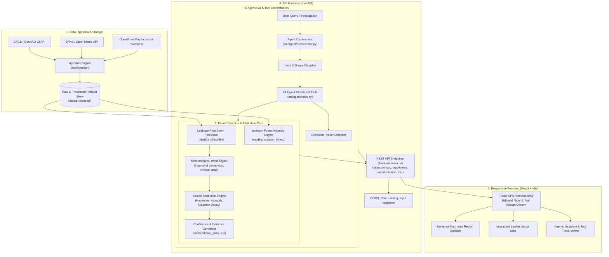

# AIR KAVACH - System Architecture & Engineering Specification

## 1. Executive Overview

**AIR KAVACH** is an operational environmental intelligence and industrial pollution source attribution platform. Designed with a **Pan-India first** architecture and future global extensibility, AIR KAVACH ingests high-frequency ambient air quality observations, applies rigorous rolling-baseline statistical and machine learning anomaly detection, evaluates meteorological wind vector alignments, and scores candidate industrial facilities using transparent, physically sound screening heuristics.

Crucially, AIR KAVACH operates as an **investigative decision-support system** that strictly distinguishes between **heuristic screening likelihood** and **proven legal causation**, exposing complete uncertainty bounds and data provenance at every stage.

---

## 2. High-Level Architectural Topology

---

## 3. Core Subsystems

### 3.1. Pan-India Geographic Scope & Data Registry (`src/geo/`)
- **Canonical Registry (`src/geo/registry.py`)**: Defines normalized ISO-style region identifiers (`in-mp-indore`, `in-dl-delhi`, `in-mh-mumbai`, `in-gj-ahmedabad`, `in-ka-bengaluru`, `in-up-kanpur`).
- **Strict Geographic Isolation**: Every query accepts an explicit region parameter. Regions without live sensor feeds return truthful `CoverageStatus.FEEDS_PENDING` with 0 observations and 0 events. Under no circumstances is Indore data leaked or substituted into another region.
- **Geodetic Calculations**: All coordinates are verified under EPSG:4326 (WGS84). Distance calculations use the Haversine great-circle formula, and bearing calculations use forward spherical azimuth.

### 3.2. Data Processing & Temporal Integrity (`src/event_detection/`, `src/features/`)
- **Leakage-Free Rolling Baselines**: Baselines use `shift(1).rolling(window=96, min_periods=24)` to ensure that elevated pollutant concentrations during a spike do not artificially inflate the baseline mean or standard deviation.
- **Gap-Aware Temporal Segmentation**: Continuous sensor reading sequences are segmented whenever a temporal gap exceeding 30 minutes is detected, preventing rolling statistics from bridging unmonitored periods.
- **Event Extraction**: Sustained elevations where $Z > 2.0$ for at least 4 consecutive 15-minute intervals ($\ge 1$ hour) are clustered into discrete events with deterministic identifiers (`EVT-0001` through `EVT-0048`).

### 3.3. Machine Learning Anomaly Detection (`src/ml/`)
- **Isolation Forest Classifier**: Trained per-station with 300 estimators, 2% contamination parameter, and 4-feature rolling representation (current value, 24h rolling mean, rolling std, rate-of-change).
- **Dual-Scoring Paradigm**: Both parametric statistical Z-scores and non-parametric ML anomaly scores are preserved side-by-side to allow robust validation across diverse atmospheric patterns.

### 3.4. Scientific Atmospheric Attribution (`src/attribution/`)
- **Wind "FROM" Vector Convention**: Meteorological wind direction indicates the azimuth from which wind originates. When wind is from 270° (W) blowing toward 90° (E), a candidate facility located at 270° from the sensor is directly upwind.
- **Circular Angle Difference**: Computed via `(angle_diff + 180) % 360 - 180` to eliminate boundary singularities at 0°/360°.
- **Distance Decay**: Exponential atmospheric dispersion formulation $S_{dist} = \exp(-d / d_0)$ with $d_0 = 5.0\text{ km}$.
- **Composite Screening Score**:
  $$S_{candidate} = 0.70 \cdot \max(0, \cos(\Delta\theta)) + 0.30 \cdot \exp(-d / 5.0)$$
- **Scientific Guardrails**: If $S_{candidate} < 0.35$ or wind data is unavailable, the candidate is categorized as `insufficient_evidence` or `inconclusive`. The score is explicitly documented as a geometric screening index, **never as a probability of causation**.

### 3.5. Agentic AI & Tool Execution Architecture (`src/agent/`)
- **Deterministic Tool Calling**: 14 strictly typed, allowlisted Python functions in `src/agent/tools.py` wrap every analytical capability.
- **Orchestration Workflow (`src/agent/orchestrator.py`)**:
  1. User natural language prompt received.
  2. Intent & region classification (with deterministic entity extraction).
  3. Pre-flight dependency graph planning.
  4. Sequential tool execution with state passing.
  5. Missing-evidence audit and warning synthesis.
  6. Final response generation alongside complete JSON execution trace.

### 3.6. Backend API Gateway (`backend/main.py`)
- **FastAPI Core**: Asynchronous, highly performant HTTP service running on Uvicorn.
- **Contract Enforcement**: Pydantic v2 domain models for all inputs and responses (`src/utils/schemas.py`).
- **Endpoints**: 20+ REST endpoints covering health/readiness, summary, coverage, stations, observations, events, candidate attribution, evidence trees, interactive map layers, ingestion jobs, model training triggers, reports, and AI assistant investigations.

### 3.7. Frontend User Interface (`frontend/src/`)
- **Modern React + Vite Architecture**: Ultra-fast single-page web application styled with a clean editorial aesthetic.
- **Design Tokens**:
  - Background: Off-white canvas `#F7F8F6`
  - Primary Typography & Heavy Accents: Deep Navy `#1D3557`
  - Secondary Accents & Interactive Elements: Rich Teal `#3C8D91`
  - Editorial Accents: Serif italics, hairline borders, organic SVG dividers
- **Universal Region Bar**: Top-level header selector with real-time status badges, instant data switching, and clear "Feeds Pending" notifications.
- **Interactive Leaflet Mapping**: Dual-layer vector rendering showing monitoring stations, candidate industrial facilities, wind vectors, and dispersion cones.

---

## 4. Security & Compliance Architecture

- **Path Traversal Protection**: All file read/write operations validate target paths against project boundaries using strict absolute path resolution.
- **Input Sanitization**: Pydantic schemas enforce type bounds, ISO date validation, and enumeration checks.
- **CORS Hardening**: Configurable origins via environment variables, defaulting to local development ports.
- **Secret Zero Principle**: No external API keys or credentials are committed to source control or logged in runtime traces. Deterministic fallback paths ensure 100% platform operability without external cloud keys.

---

## 5. Technology Stack Summary

| Layer | Component | Technology / Library |
|---|---|---|
| **Language** | Core Runtime | Python 3.13 / Node.js 24 |
| **Backend Framework** | Web / API | FastAPI 0.115+, Uvicorn, Pydantic v2 |
| **Data Processing** | Analytics | Pandas 2.2+, NumPy 2.0+, PyArrow |
| **Machine Learning** | Anomaly Detection | Scikit-Learn 1.6+ (`IsolationForest`), Joblib |
| **Frontend Framework** | Web UI | React 18+, Vite 8+, Tailwind CSS |
| **Geospatial & Mapping** | Visualization | Leaflet 1.9+, React-Leaflet |
| **Containerization** | Deployment | Docker, Docker Compose, Nginx Alpine |
| **Testing** | QA | Pytest 9+, AnyIO, Requests |
