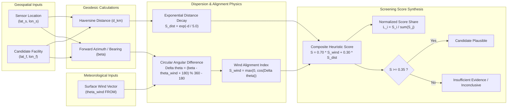

# AIR KAVACH - Scientific Attribution Methodology & Atmospheric Modeling Specification

## 1. Executive Scientific Overview

The AIR KAVACH Source Attribution Engine is a **geometric and meteorological screening framework** designed to identify industrial facilities that are **spatially and meteorologically plausible candidates** for contributing to detected ambient air quality spikes.

> [!IMPORTANT]
> **Scientific Guardrail: Screening Likelihood vs. Legal Causation**  
> AIR KAVACH computes a **heuristic screening score**, NOT a proven physical probability or legal determination of guilt. An elevated attribution score indicates that a facility was geographically positioned upwind from a sensor during an event and within plausible dispersion range. It does NOT prove that emissions occurred, nor does it quantify the facility's exact emission mass rate without direct in-stack continuous emissions monitoring (CEMS) telemetry.

---

## 2. Mathematical Formulation

### 2.1 Geodetic Distance (Haversine Formulation)
The great-circle distance $d$ between monitoring station $(\phi_1, \lambda_1)$ and candidate facility $(\phi_2, \lambda_2)$ on spherical Earth ($R = 6371.0\text{ km}$):
$$\Delta\phi = \phi_2 - \phi_1, \quad \Delta\lambda = \lambda_2 - \lambda_1$$
$$a = \sin^2\left(\frac{\Delta\phi}{2}\right) + \cos(\phi_1)\cos(\phi_2)\sin^2\left(\frac{\Delta\lambda}{2}\right)$$
$$d = 2 R \cdot \arcsin\left(\sqrt{a}\right)$$

### 2.2 Forward Geodetic Azimuth (Bearing)
The initial bearing $\beta \in [0^\circ, 360^\circ)$ from sensor toward candidate facility:
$$y = \sin(\Delta\lambda)\cos(\phi_2)$$
$$x = \cos(\phi_1)\sin(\phi_2) - \sin(\phi_1)\cos(\phi_2)\cos(\Delta\lambda)$$
$$\beta = \left(\text{atan2}(y, x) \cdot \frac{180}{\pi} + 360\right) \pmod{360}$$

### 2.3 Meteorological Wind "FROM" Convention & Alignment
Meteorological wind direction $\theta_{wind}$ specifies the azimuth **from which** the wind originates (0° = North, 90° = East, 180° = South, 270° = West).

When wind originates from direction $\theta_{wind}$, air parcels travel toward direction $\theta_{wind} + 180^\circ$. For an industrial facility to contribute emissions to a sensor, the facility must be located **upwind** of the sensor:
$$\text{Facility Bearing from Sensor } \beta \approx \theta_{wind}$$

#### Minimal Circular Angular Difference:
$$\Delta\theta = ((\beta - \theta_{wind} + 180) \pmod{360}) - 180$$
$$\Delta\theta \in [-180^\circ, +180^\circ]$$

#### Directional Alignment Index:
$$S_{wind} = \max\left(0, \cos(\Delta\theta)\right)$$
- If $\Delta\theta = 0^\circ$ (facility perfectly upwind): $S_{wind} = 1.00$
- If $|\Delta\theta| = 45^\circ$ (within typical plume dispersion cone): $S_{wind} = \cos(45^\circ) = 0.707$
- If $|\Delta\theta| = 90^\circ$ (crosswind): $S_{wind} = 0.00$
- If $|\Delta\theta| > 90^\circ$ (facility is downwind): $S_{wind} = 0.00$ (downwind sources cannot transport mass against mean wind)

### 2.4 Atmospheric Dispersion Distance Decay
Pollutant concentrations downwind of a point source decrease rapidly due to horizontal and vertical turbulent atmospheric dispersion (Gaussian plume behavior). We model this proximity decay exponentially:
$$S_{dist} = \exp\left(-\frac{d}{d_0}\right)$$
where $d_0 = 5.0\text{ km}$ represents the characteristic urban boundary-layer dispersion scale.
- At $d = 0\text{ km}$: $S_{dist} = 1.00$
- At $d = 5\text{ km}$: $S_{dist} = 0.368$
- At $d = 10\text{ km}$: $S_{dist} = 0.135$
- At $d = 20\text{ km}$: $S_{dist} = 0.018$

### 2.5 Composite Screening Score
The composite screening index balances directional plume transport (70%) with proximity (30%):
$$S_{candidate} = 0.70 \cdot S_{wind} + 0.30 \cdot S_{dist}$$

Candidates within $r \le 25\text{ km}$ are evaluated. If $\theta_{wind}$ is missing, or if $S_{candidate} < 0.35$, the event is classified as `insufficient_evidence` or `inconclusive`.

### 2.6 Relative Likelihood Share
For an event with $M$ candidates having $S_i \ge 0.35$:
$$L_i = \frac{S_i}{\sum_{j=1}^M S_j}$$
This normalizes the candidate pool to sum to 1.0, highlighting relative prominence among plausible upwind emitters.

---

## 3. Evidence Classification Taxonomy

| Attribution Score Range | Minimal Angular Difference $|\Delta\theta|$ | Evidence Label | Operational Interpretation |
|---|---|---|---|
| $S \ge 0.70$ | $|\Delta\theta| \le 30^\circ$ | `strong_geospatial_wind_evidence` | Candidate is directly upwind and within close proximity ($\le 8\text{ km}$). High priority for field inspection. |
| $0.45 \le S < 0.70$ | $|\Delta\theta| \le 60^\circ$ | `upwind_evidence` | Candidate lies within the broader atmospheric dispersion cone. Plausible contributor. |
| $0.35 \le S < 0.45$ | $|\Delta\theta| \le 90^\circ$ | `moderate_proximity_weak_alignment` | Marginally upwind or proximate; contribution cannot be ruled out or confirmed. |
| $S < 0.35$ | Any | `downwind_low_plausibility` / `insufficient_evidence` | Plume trajectory is contradictory or too distant to explain sensor spike. |
| Wind Missing | N/A | `inconclusive_missing_wind` | Meteorological wind data absent. No physical attribution possible. |

---

## 4. Scientific Assumptions & Model Limitations

1. **Stationary & Homogeneous 2D Wind Field**: The engine assumes that surface wind measured at 10m AGL is representative of horizontal transport across the 25km radius. Complex terrain, urban street canyons, and thermal updrafts may cause localized wind veering.
2. **Effective Stack Height & Plume Rise**: Without stack height, gas exit velocity, and exit temperature, buoyant plume rise cannot be modeled. Surface-level sources (e.g., fugitive dust) disperse differently from tall industrial stacks (which may overshoot surface monitors during nocturnal inversions).
3. **Absence of Emission Inventory Telemetry**: Ranking does not account for whether a facility was actively operating or shut down for maintenance during the event hours unless CEMS telemetry is integrated.
4. **Distinction from Complex Numerical Dispersion Models**: This framework serves as a high-speed, transparent **first-response screening tool**. For formal environmental litigation, full 3D Lagrangian particle dispersion models (such as NOAA HYSPLIT or EPA AERMOD / CALPUFF) utilizing full boundary-layer profile soundings are recommended as secondary confirmation.
