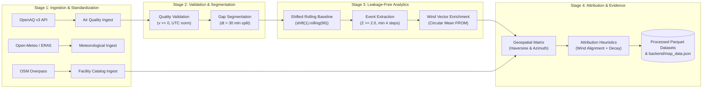

# AIR KAVACH - Data Pipeline & Processing Specification

## 1. Pipeline Architecture Overview

The AIR KAVACH data pipeline processes atmospheric observations and geospatial features through a multi-stage, reproducible, and leakage-free analytical pipeline. Every stage writes immutable Parquet datasets with explicit schemas, enabling complete data provenance from raw sensor telemetry to candidate source rankings.



---

## 2. Ingestion Specifications

### 2.1 Air Quality Ingestion (`src/ingestion/openaq_client.py`)
- **Source**: OpenAQ v3 REST API (`https://api.openaq.org/v3/`).
- **Target Parameters**: `pm25` (primary), `pm10`, `no2`, `so2`, `co`, `o3`.
- **Temporal Frequency**: 15-minute continuous observations.
- **Normalization Rules**:
  - Timestamps parsed to ISO 8601 and normalized to UTC (`datetime64[ns, UTC]`).
  - Values must satisfy $v \ge 0.0\ \mu\text{g/m}^3$. Negative or physical impossibilities ($> 2000.0\ \mu\text{g/m}^3$) are logged and excluded.
  - Coordinates mapped to WGS84 decimal degrees with $\ge 4$ decimal places.
- **Incremental & Idempotent**: Deduplication is performed on composite primary key `(station, parameter, timestamp)`. Existing records are updated only if incoming telemetry is of higher quality.

### 2.2 Meteorological Ingestion (`src/ingestion/weather_client.py`)
- **Source**: Open-Meteo Historical / ECMWF ERA5 Reanalysis.
- **Parameters**: 10-meter surface horizontal wind speed ($U_{10}$), 10-meter wind direction ($\theta_{10}$ in degrees), temperature ($T_{2m}$), and surface pressure ($P_{sfc}$).
- **Convention Standard**: Meteorological wind direction adheres strictly to the **FROM** convention (direction wind is blowing from, clockwise from True North: 0° = North, 90° = East, 180° = South, 270° = West).

### 2.3 Industrial Facilities Ingestion (`src/ingestion/facilities_client.py`)
- **Source**: OpenStreetMap Overpass API (`[landuse=industrial]`, `[man_made=works]`, `[industrial=*]`).
- **Filtering**: Restrict to certified industrial polygons and nodes within the target geographic bounding box. Centroids computed for polygon features.

---

## 3. Data Cleansing & Gap Segmentation

Real-world CAAQMS telemetry suffers from power outages, sensor calibrations, and telemetry drops. Bridging these gaps with continuous rolling windows introduces severe statistical artifacts.

### 3.1 Gap Segmentation Algorithm
1. Telemetry is grouped by station and pollutant, and sorted strictly by timestamp in ascending order:
   $$\Delta t_i = t_i - t_{i-1}$$
2. If $\Delta t_i > 30\text{ minutes}$ (missing $\ge 2$ expected 15-minute readings), a **segment boundary** is injected:
   $$\text{segment\_id}_i = \sum_{j=1}^i \mathbf{1}(\Delta t_j > 30\text{ min})$$
3. Rolling statistics are calculated **strictly within contiguous segments**. Rolling windows never cross segment boundaries.

---

## 4. Leakage-Free Rolling Baseline Computation

A critical flaw in naive pollution anomaly systems is including the spike period inside the rolling baseline, which artificially inflates the rolling mean $\mu$ and standard deviation $\sigma$, reducing the apparent significance of the event.

### 4.1 Implementation
For a 24-hour retrospective baseline (96 intervals of 15 minutes):
$$\mu_{t} = \frac{1}{K} \sum_{k=1}^K x_{t-k}, \quad \text{where } K \le 96 \text{ (min 24)}$$
$$\sigma_{t} = \sqrt{\frac{1}{K-1} \sum_{k=1}^K (x_{t-k} - \mu_{t})^2}$$

In Pandas code:
```python
df["baseline_mean"] = (
    df.groupby("segment_id")["value"]
    .apply(lambda s: s.shift(1).rolling(window=96, min_periods=24).mean())
    .reset_index(level=0, drop=True)
)
df["baseline_std"] = (
    df.groupby("segment_id")["value"]
    .apply(lambda s: s.shift(1).rolling(window=96, min_periods=24).std())
    .reset_index(level=0, drop=True)
)
df["z_score"] = (df["value"] - df["baseline_mean"]) / df["baseline_std"].replace(0, np.nan)
```
The explicit `.shift(1)` guarantees that the observation at time $t$ has **zero statistical influence** on its own baseline.

---

## 5. Event Extraction & Clustering

1. **Threshold Filtering**: Any reading with $Z \ge 2.0$ (concentration exceeding 2 standard deviations above recent baseline) is marked as active anomaly.
2. **Persistence Filtering**: Anomalies must persist for at least 4 consecutive 15-minute intervals ($\ge 60\text{ minutes}$) to eliminate transient sensor noise.
3. **Clustering & Serialization**: Contiguous anomaly periods are clustered into discrete events with deterministic identifiers (`EVT-0001`, `EVT-0002`, etc.) and serialized into `data/features/pollution_events.parquet`.

---

## 6. Meteorological Wind Alignment & Feature Matrix

For each detected event:
1. Extract meteorological wind readings between $[t_{start}, t_{end}]$.
2. Compute circular mean wind direction using unit vector decomposition:
   $$\bar{u} = -\frac{1}{N}\sum \sin(\theta_i), \quad \bar{v} = -\frac{1}{N}\sum \cos(\theta_i)$$
   $$\theta_{mean} = \text{atan2}(-\bar{u}, -\bar{v}) \pmod{360}$$
3. Join candidate facilities within $25\text{ km}$ radius of the station.
4. Calculate geodetic bearing $\beta$ and minimal circular angular difference $|\Delta\theta| = |(\beta - \theta_{mean} + 180) \pmod{360} - 180|$.
5. Compute composite screening scores and emit final feature datasets.

---

## 7. Pipeline Execution & Scheduling

The pipeline can be triggered on-demand via the REST API or run as a batch CLI workflow:

```bash
# 1. Ingestion status and check
python -m src.ingestion.openaq_client

# 2. Event detection and baseline calculation
python -m src.event_detection.event_processor

# 3. Wind vector alignment
python -m src.features.event_wind_alignment

# 4. Attribution scoring and candidate ranking
python -m src.attribution.attribution_engine
python -m src.attribution.confidence

# 5. Precompute GeoJSON evidence map
python -m src.evidence.map_data
```
All pipeline steps are verified by automated tests in `tests/test_event_detection.py` and `tests/test_end_to_end_investigation.py`.
