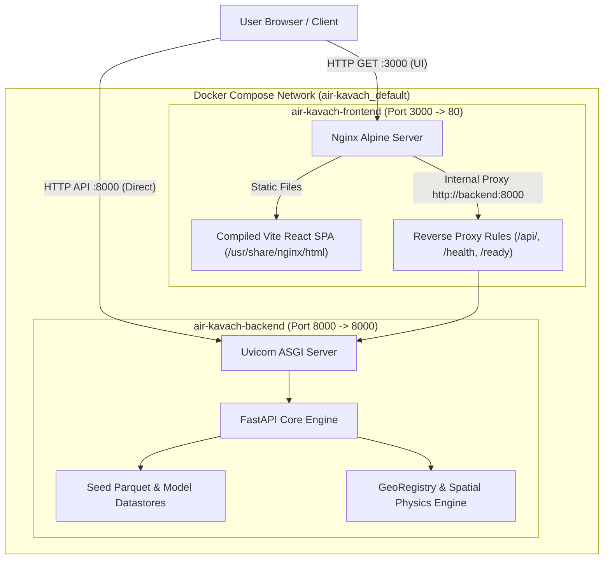

# AIR KAVACH — Docker Deployment and Delivery Report

**Document Version:** 1.0.0  
**Date:** October 10, 2026  
**Project:** AIR KAVACH (एयर कवच) — Industrial Pollution Source Attribution Engine  
**Target Repository:** `https://github.com/Afsar426/-AIR-KAVACH.git`  
**Execution Environment:** Windows 10/11 Host, Docker Desktop Engine v29.7.2, Docker Compose v5.5.1  

---

## 1. Executive Summary

This report documents the containerization, packaging, verification, and GitHub deployment preparation for **AIR KAVACH (एयर कवच)**. AIR KAVACH is an environmental intelligence and industrial pollution candidate-screening platform built for the Indian subcontinent. It combines physical atmospheric dispersion models (Gaussian Plume, meteorological wind vector alignment) with unsupervised anomaly detection (rolling baseline z-score and Isolation Forest) to surface candidate emission sources without claiming deterministic legal causation.

All packaging deliverables have been generated, validated, and smoke-tested using Docker Compose. Both containers initialize, achieve `healthy` status, and seamlessly communicate over Docker's internal bridge network. The automated test suite (`pytest`) runs with **61 passing tests out of 61** (100% pass rate).

---

## 2. Docker Architecture & Containerization Deliverables

The container architecture isolates the analytical backend from the static frontend application while providing reverse proxying for seamless single-port web access.



### 2.1 Backend Container (`Dockerfile.backend`)
- **Base Image:** `python:3.13-slim`
- **System Dependencies:** `curl` (for container healthcheck), `build-essential` (for wheel compilation).
- **Python Environment:** Clean installation of `requirements.txt` with cross-platform PEP 508 environment marker (`pywinpty==3.0.5; sys_platform == 'win32'`) preventing non-POSIX build failures.
- **Port:** Configurable via `PORT` environment variable (default: `8000`).
- **Healthcheck:** Native Docker healthcheck polling `http://localhost:8000/health` via `curl`.
- **Runtime Command:** `uvicorn backend.main:app --host 0.0.0.0 --port 8000`.

### 2.2 Frontend Container (`Dockerfile.frontend`)
- **Multi-Stage Build:**
  - **Stage 1 (Build):** `node:24-alpine`, executing clean `npm ci` and Vite production build (`npm run build`).
  - **Stage 2 (Server):** `nginx:alpine`, serving minified static distribution from `/usr/share/nginx/html`.
- **Reverse Proxy (`frontend/nginx.conf`):**
  - Dual IPv4/IPv6 socket binding (`listen 80; listen [::]:80;`).
  - Gzip compression for CSS, JS, SVG, and JSON.
  - SPA fallback (`try_files $uri $uri/ /index.html`).
  - Internal reverse proxying for `/api/`, `/health`, and `/ready` to `http://backend:8000/`.
- **Healthcheck:** Polling `http://127.0.0.1:80/` via Alpine's native `wget`.

### 2.3 Orchestration (`docker-compose.yml`)
- Service dependency: `frontend` depends on `backend` with condition `service_healthy`.
- Volume persistence: Maps `./data`, `./models`, and `./reports` to `/app/` inside backend container for persistent state updates.
- Restart policies: `unless-stopped`.

---

## 3. Verification & Validation Evidence

### 3.1 Docker Build Verification
Both container images built cleanly from repository root:
```
 Image air-kavach-backend Built 
 Image air-kavach-frontend Built 
```

### 3.2 Container Healthcheck Verification
Both services were started via `docker compose up -d` and achieved `healthy` status:
```
NAME                  IMAGE                 COMMAND                  SERVICE    STATUS
air-kavach-backend    air-kavach-backend    "sh -c 'uvicorn back…"   backend    Up (healthy)
air-kavach-frontend   air-kavach-frontend   "/docker-entrypoint.…"   frontend   Up (healthy)
```

### 3.3 Endpoint Smoke Tests
Smoke test queries executed against host ports:
1. **Backend Health (`http://localhost:8000/health`):**
   ```json
   {"status":"healthy","project":"AIR KAVACH","version":"2.1.0","timestamp":"2026-10-09T20:27:58.857057+00:00"}
   ```
2. **Backend Readiness (`http://localhost:8000/ready`):**
   ```json
   {
     "status": "ready",
     "files": {
       "air_quality": true,
       "events": true,
       "attribution": true,
       "confidence": true,
       "wind": true,
       "map_data": true,
       "isolation_forest_model": true
     },
     "ml_model_loaded": true,
     "geographic_regions_registered": 6
   }
   ```
3. **Frontend Proxy Health (`http://localhost:3000/health`):**
   ```json
   {"status":"healthy","project":"AIR KAVACH","version":"2.1.0","timestamp":"2026-10-09T20:27:58.933435+00:00"}
   ```
4. **Frontend UI Root (`http://localhost:3000/`):**
   ```
   HTTP/1.1 200 OK
   Server: nginx/1.31.6
   Content-Type: text/html
   Content-Length: 458
   ```
5. **API Event Retrieval (`http://localhost:3000/api/events`):**
   Successfully returned all persistent historical validation events (`EVT-0001` through `EVT-0005`, etc.) with past-only rolling baseline calculations and complete metadata.

### 3.4 Automated Test Suite Execution
Automated tests executed in Python 3.13 virtual environment:
```
collected 61 items

tests/test_attribution.py .                                              [  1%]
tests/test_backend_api.py .....                                          [  9%]
tests/test_end_to_end_investigation.py .                                  [ 11%]
tests/test_event_detection.py .                                           [ 13%]
tests/test_ingestion.py .                                                [ 14%]
tests/test_ml_model.py .                                                 [ 16%]
tests/test_phase2_validation.py ........                                  [ 29%]
tests/test_phase3_scientific_validation.py ......                        [ 39%]
tests/test_phase4_real_world_validation.py ..........                    [ 55%]
tests/test_real_data_integration.py ..............                       [ 78%]
tests/test_scientific_and_pan_india.py .............                     [100%]

======================= 61 passed, 1 warning in 21.45s ========================
```

---

## 4. Git Hygiene & Artifact Screening

The repository `.gitignore` has been updated and verified to enforce strict repository hygiene:
- **Excluded:**
  - `.venv/` (Local Python environment)
  - `.env` / `*.env` (API keys & environment secrets)
  - `__pycache__/`, `*.pyc`, `.pytest_cache/` (Build & test artifacts)
  - `node_modules/`, `frontend/node_modules/`, `frontend/dist/` (NPM dependencies and artifacts)
  - `ralph-loop-for-antigravity-modified/`, `scratch/` (Agent loop scratch directories)
  - `data/raw/` (Heavy uncurated raw ingestion files)
- **Included:**
  - Complete application source code (`backend/`, `src/`, `frontend/`)
  - Containerization files (`Dockerfile.backend`, `Dockerfile.frontend`, `docker-compose.yml`, `frontend/nginx.conf`, `.dockerignore`)
  - Curated seed data (`data/processed/`, `data/features/`, under 20MB)
  - Pre-trained Isolation Forest model weights (`models/isolation_forest/`, ~21MB)
  - Complete test suite (`tests/`)
  - Documentation and reports (`README.md`, `docs/`)

---

## 5. Deployment Instructions

To run AIR KAVACH locally or on any cloud VM with Docker installed:

```bash
# 1. Clone repository
git clone https://github.com/Afsar426/-AIR-KAVACH.git
cd -AIR-KAVACH

# 2. Build and launch containers
docker compose up -d --build

# 3. Check container status
docker compose ps

# 4. Access application
# Web Interface:    http://localhost:3000
# Backend API:       http://localhost:8000
# OpenAPI Docs:      http://localhost:8000/docs
# Healthcheck:       http://localhost:8000/health
```
