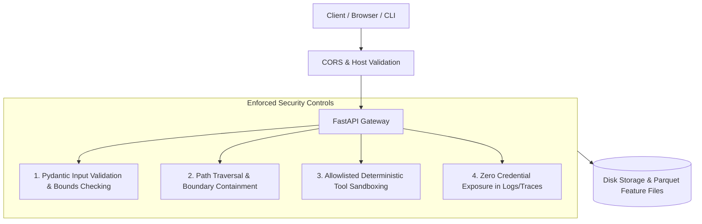

# AIR KAVACH - Application Security & Governance Policy

## 1. Security Architecture & Threat Model

AIR KAVACH processes ambient environmental telemetry, geospatial intelligence, and automated AI investigative inferences. The platform adheres to defense-in-depth principles across its REST APIs, agent tool executions, and file storage subsystems.



---

## 2. Key Security Defenses

### 2.1 Input Validation & Strong Schema Typing
- **Pydantic v2 Models**: All incoming request payloads (`/api/assistant/investigate`, `/api/reports`, `/api/models/train`, `/api/ingestion/run`) are strictly validated against strongly typed Pydantic models (`src/utils/schemas.py`).
- **Identifier Pattern Enforcement**: Event identifiers must match `^EVT-\d{4}$`. Facility identifiers must conform to `^[A-Za-z0-9\-_]+$`. Unrecognized formats are rejected immediately with HTTP 422 Unprocessable Entity.
- **Geographic Coordinate Validation**: Latitudes must reside within $[-90.0, +90.0]$ and longitudes within $[-180.0, +180.0]$.

### 2.2 Path Traversal Prevention
- File read and write operations (such as saving or retrieving investigation reports in `reports/`) resolve absolute canonical paths and verify containment:
```python
base_dir = Path("reports").resolve()
target_path = (base_dir / filename).resolve()
if not str(target_path).startswith(str(base_dir)):
    raise HTTPException(status_code=400, detail="Invalid file path")
```
- Direct user-controlled path strings are never passed directly to disk operations.

### 2.3 Command Injection Mitigation
- **Allowlisted Tool Execution**: The Agentic AI assistant (`src/agent/orchestrator.py`) cannot invoke arbitrary shell or system commands. Every tool is an explicitly registered Python function in `src/agent/tools.py`.
- No `eval()`, `exec()`, or unrestricted shell subprocess calls are exposed to client inputs.

### 2.4 Cross-Origin Resource Sharing (CORS) Hardening
- By default, CORS middleware restricts access to explicit local frontend hosts (`http://localhost:3000`, `http://localhost:5173`).
- Wildcard CORS (`allow_origins=["*"]`) combined with credentials is explicitly forbidden in production configuration.

### 2.5 Secret Zero Principle & Data Privacy
- **Zero Committed Secrets**: Source code contains no embedded API keys, database credentials, or secret tokens.
- **Trace Sanitization**: The agent execution trace logger (`src/agent/orchestrator.py`) scrubs potential environment tokens from serialized JSON traces.
- **Offline Determinism**: The system operates with full analytical functionality in air-gapped environments without external LLM API keys.

### 2.6 Denial of Service (DoS) Mitigation
- **Query Bounds**: Observation endpoints enforce pagination bounds (`limit <= 1000`).
- **Vector Range Capping**: Attribution calculations enforce a maximum geospatial screening radius ($r \le 25\text{ km}$), bounding the cross-product complexity.

---

## 3. Vulnerability Reporting

If you identify a security vulnerability in AIR KAVACH, please disclose it responsibly:
- **Email**: `security@airkavach.org` (or create a private GitHub Security Advisory)
- Include detailed reproduction steps and affected components.
- Do not disclose issues publicly until a fix has been verified and released.
